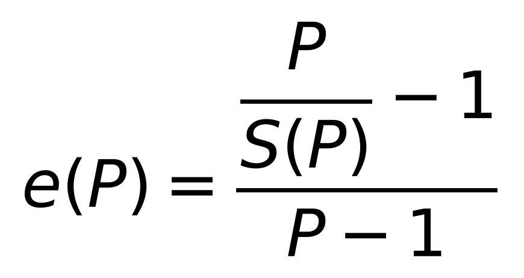
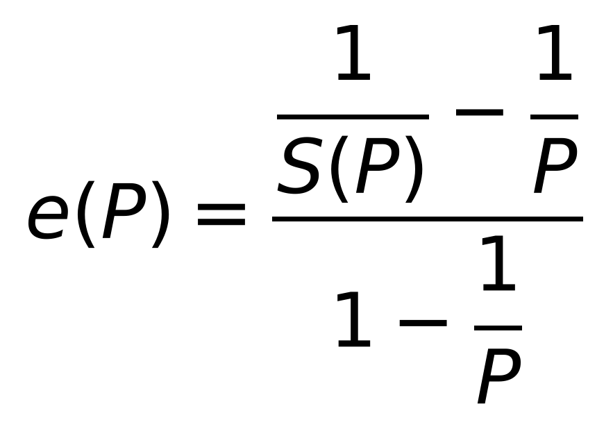

**Picture version (shows in every viewer; copy and paste it as an image):**

{width=7cm}

**Equivalent form (original Karp–Flatt definition):**

{width=7cm}

**Editable Word equation (select it, copy, and paste into the thesis):**

$$e(P)=\frac{\dfrac{P}{S(P)}-1}{P-1}$$

where $S(P)$ is the speedup obtained with $P$ processes and $e(P)$ is the experimentally determined serial fraction, $P > 1$.

**In Word, if you want to type it yourself:** Insert → Equation → Fraction (Stacked). In the upper box insert another stacked fraction ($P$ over $S(P)$) and type −1 after it; in the lower box type P − 1. Then type e(P) = in front of it.
